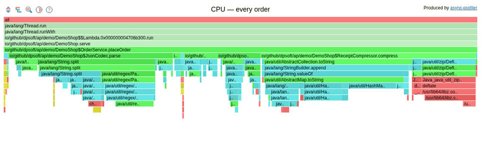

*[async-profiler] over HTTP — one `-javaagent`, nothing to install. CPU, wall clock, allocations, locks and native
memory as interactive flame graphs, heatmaps, JFR or Go-compatible pprof.*

[](https://central.sonatype.com/artifact/io.github.dpsoft/ap-agent)
[](https://github.com/dpsoft/ap-agent/actions/workflows/build.yml)
[](docs/configuration.md#requirements)
[](https://github.com/async-profiler/async-profiler)
[](LICENSE)

---



*One `curl` against a running JVM: 30 seconds of CPU come back as an async-profiler 4.6 flame graph — zoom into a
frame, search with a regex, switch to the tree view. [Open it live](https://htmlpreview.github.io/?https://github.com/dpsoft/ap-agent/blob/main/docs/assets/flame-cpu.html).*

---

## What it does

- **Every async-profiler event over HTTP**: `cpu`, `wall`, `alloc`, `lock` and `nativemem` (in bytes with
  `params=total`), one request per profile. [Parameters and recipes →](docs/usage.md)
- **Ready-to-share outputs**: interactive flame graph and tree view, heatmap, JFR for JDK Mission Control,
  collapsed stacks and pprof.
- **Go pprof compatible**: `go tool pprof http://host:8080/debug/pprof/profile` just works. [Go mode →](docs/go-mode.md)
- **Span filtering**: tag your own units of work and keep only their samples, by tag regex or latency.
  [How spans work →](docs/span-filtering.md)
- **Nothing to install**: [AP-Loader] bundles the native profiler for Linux x64/arm64 and macOS; a profiler that
  cannot load is logged and never stops your application.
- **Self-contained**: a 1.8 MB shaded jar whose dependencies cannot clash with yours, also usable as a
  library. [Library usage →](docs/library-usage.md)

## Quickstart

```bash
curl -LO https://repo1.maven.org/maven2/io/github/dpsoft/ap-agent/0.2.0/ap-agent-0.2.0.jar
java -javaagent:ap-agent-0.2.0.jar -jar my-app.jar

# 30 seconds of CPU as a flame graph, or wall clock / allocations / locks / native memory
curl -o cpu.html "http://localhost:8080/profiler/profile?event=cpu&output=flame&duration=30"

# or straight into pprof
go tool pprof -http :8000 "http://localhost:8080/profiler/profile?event=cpu&output=pprof&duration=30"
```

The endpoint has no authentication and listens on all interfaces: bind it with `-Dap-agent.server.host=127.0.0.1`
or keep the port private. [Configuration →](docs/configuration.md)

## Documentation

| | |
|---|---|
| [Usage](docs/usage.md) | parameters, outputs, errors and recipes per event |
| [Span filtering](docs/span-filtering.md) | profiles of your own units of work |
| [Go mode](docs/go-mode.md) | the `/debug/pprof/*` endpoints |
| [Configuration](docs/configuration.md) | settings, Docker and Kubernetes, requirements |
| [Library usage](docs/library-usage.md) | serving profiles from your own HTTP endpoints |
| [Upgrading from 0.1.x](docs/upgrading.md) | behaviour and API changes |
| [Contributing](CONTRIBUTING.md) | building, the test suites and the benchmarks |

---

[Contributing](CONTRIBUTING.md) · [License](LICENSE) (Apache-2.0) ·
built on [async-profiler] and [AP-Loader]

[async-profiler]: https://github.com/async-profiler/async-profiler
[AP-Loader]: https://github.com/jvm-profiling-tools/ap-loader
