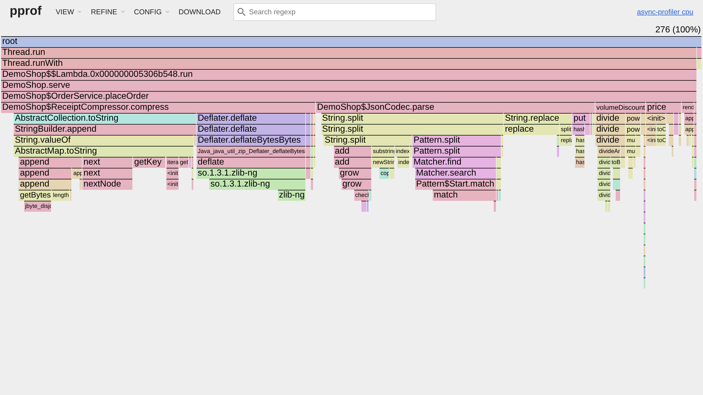

# Go mode

With `-Dap-agent.handler.go-mode=true` the agent also serves the [pprof] endpoints, and responds with pprof by default:

```shell
java -Dap-agent.handler.go-mode=true -javaagent:ap-agent-0.2.0.jar -jar my-app.jar

go tool pprof -http :8000 "http://localhost:8080/debug/pprof/profile?seconds=30"
```

| Endpoint | Profile |
|---|---|
| `/debug/pprof/profile` | CPU |
| `/debug/pprof/allocs` | Heap allocations |
| `/debug/pprof/block` | Lock contention |




[async-profiler]: https://github.com/async-profiler/async-profiler
[AP-Loader]: https://github.com/jvm-profiling-tools/ap-loader
[converter options]: https://github.com/async-profiler/async-profiler/blob/master/docs/ConverterUsage.md
[pprof]: https://github.com/google/pprof
