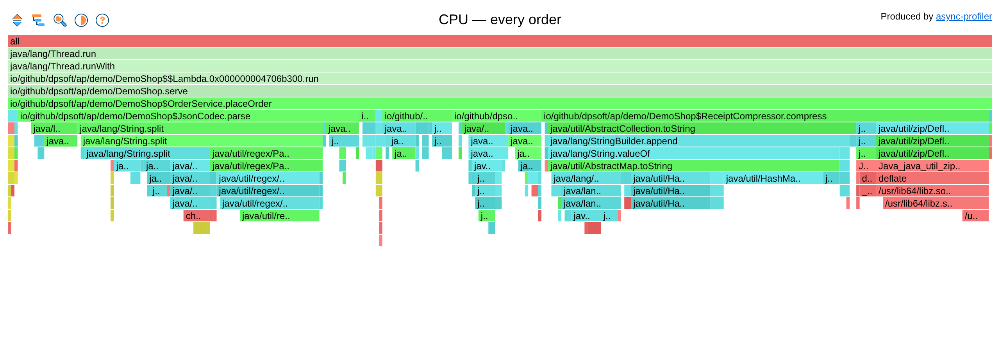
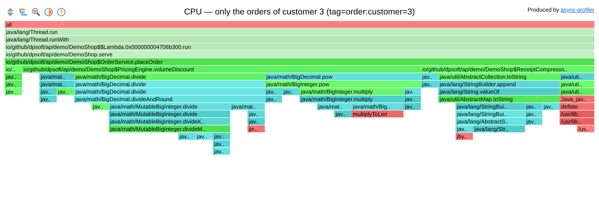

# Span filtering

async-profiler 4.5 added a Span API: mark a piece of work with a tag, and later keep only the samples recorded
inside it. To create spans, add the async-profiler API to your application, **with the same async-profiler version
as the agent (4.6)**:

```xml
<dependency>
    <groupId>tools.profiler</groupId>
    <artifactId>async-profiler</artifactId>
    <version>4.6</version>
</dependency>
```

```java
import one.profiler.Span;

public class OrderService {
    public void placeOrder(String customer) {
        long start = Span.start();
        try {
            // ... the work you want to find in the profile
        } finally {
            Span.end(start, "order:customer=" + customer);
        }
    }
}
```

Spans are only recorded while a profile is being taken, and they cost next to nothing otherwise. Then filter by tag
(a regex matching the whole tag) and/or by latency:

```shell
# only the samples taken while placing orders for customer 3
curl -G -o orders.html "http://localhost:8080/profiler/profile" \
  --data-urlencode "tag=order:customer=3" -d event=cpu -d output=flame -d duration=30

# only the samples inside spans slower than 200 ms
curl -o slow.html "http://localhost:8080/profiler/profile?event=wall&output=flame&latency=200&duration=30"
```

| Every order | Only `tag=order:customer=3` |
|---|---|
|  |  |

*The same service, two requests. Across all orders the time goes to JSON parsing and receipt compression, and the
volume discounts of customer 3 — a bulk importer placing one order in twenty — are a thin slice; filtered by its tag,
`PricingEngine.volumeDiscount` is most of each of those orders. [Interactive version](assets/flame-span-filter.html).*

> Do not add `me.bechberger:ap-loader-*` to your application: the agent already bundles AP-Loader, and a second
> copy of it on the classpath disables the agent (it logs the error and your application keeps running).

[async-profiler]: https://github.com/async-profiler/async-profiler
[AP-Loader]: https://github.com/jvm-profiling-tools/ap-loader
[converter options]: https://github.com/async-profiler/async-profiler/blob/master/docs/ConverterUsage.md
[pprof]: https://github.com/google/pprof
