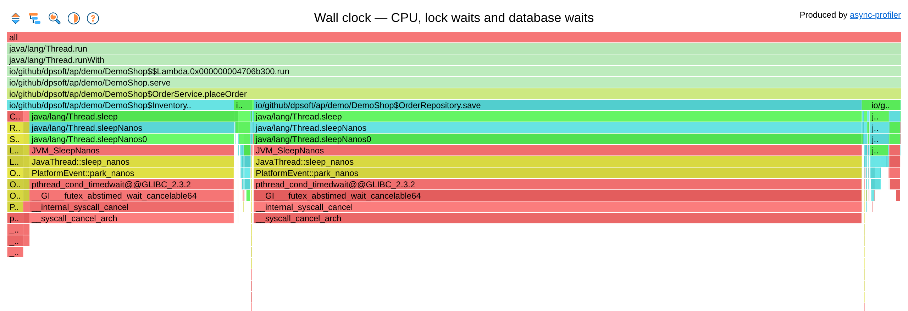
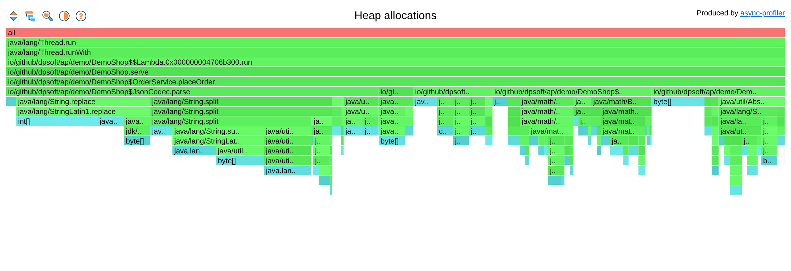
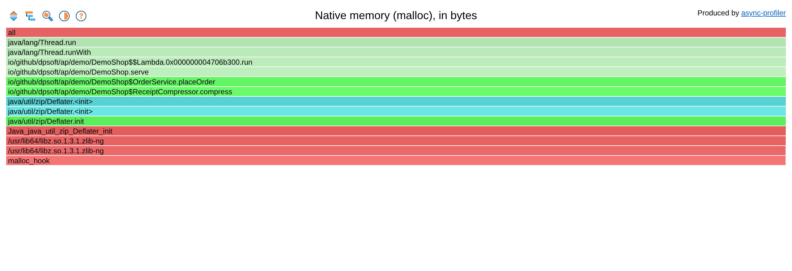
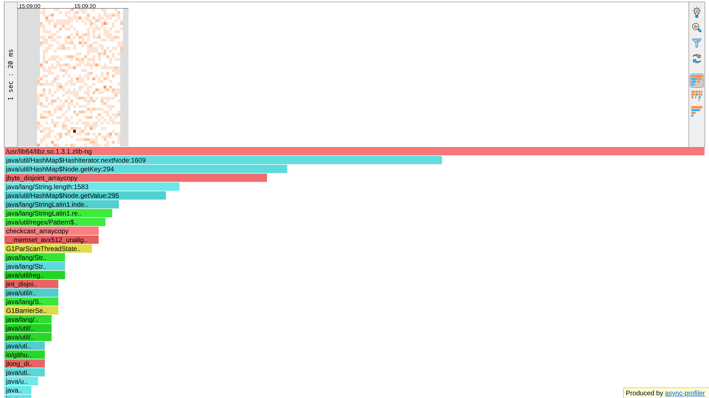

# Usage

Attach the agent with `-javaagent` and ask for profiles over HTTP: every request records for `duration` seconds and returns the converted profile.

## The `/profiler/profile` endpoint

| Parameter | Default | Description |
|---|---|---|
| `event` | `ctimer` | What to sample: `cpu`, `ctimer`, `itimer`, `wall`, `alloc`, `lock`, `nativemem`. |
| `output` | `jfr` | `flame` (or `flamegraph`), `heatmap`, `jfr`, `pprof` or `collapsed`. |
| `duration` | `30` | Seconds to record. `seconds` is accepted as an alias. |
| `interval` | `10000000` | Sampling interval: nanoseconds for CPU events, bytes for `alloc`. Defaults to the `ap-agent.profiler.interval` setting. |
| `params` | | Comma separated [converter options] such as `total`, `reverse`, `threads`, `title=My Title`: `params=total,minwidth=1` becomes `--total --minwidth 1`. |
| `tag` | | Keep only the samples recorded inside [spans](span-filtering.md) whose tag matches this regex. |
| `latency` | | Keep only the samples recorded inside spans that lasted at least this many milliseconds. |

| Output | Content-Type | Notes |
|---|---|---|
| `flame`, `flamegraph` | `text/html` | Interactive flame graph and tree view. |
| `heatmap` | `text/html` | Samples over time: select a time range to see its flame graph. |
| `collapsed` | `text/plain` | `frame;frame;frame count` lines, the input format of flame graph tools. |
| `jfr` | `application/octet-stream`, gzip | Open it with JDK Mission Control or IntelliJ IDEA. |
| `pprof` | `application/octet-stream`, gzip | For `go tool pprof` and other pprof tools. |

Errors are reported with a status code and a plain text message: `400` for invalid parameters, `404` for unknown
paths, `409` when another profiling session is running and `500` when the profiler cannot record or convert.
Remember to URL-encode values: `curl -G --data-urlencode 'tag=GET /orders.*' ...` does it for you.

## Recipes

| Profile | Request |
|---|---|
| CPU | `/profiler/profile?event=cpu&output=flame&duration=30` |
| Wall clock (threads waiting on I/O, locks, sleeps) | `/profiler/profile?event=wall&output=flame&duration=30` |
| Heap allocations | `/profiler/profile?event=alloc&output=flame&duration=30` |
| Lock contention | `/profiler/profile?event=lock&output=flame&duration=30` |
| Native memory, in bytes | `/profiler/profile?event=nativemem&output=flame&params=total&duration=30` |
| CPU over time | `/profiler/profile?event=cpu&output=heatmap&duration=60` |
| Recording for JDK Mission Control | `/profiler/profile?event=cpu&output=jfr&duration=60` |

| Wall clock | Allocations |
|---|---|
|  |  |
| **Native memory (bytes)** | **Heatmap** |
|  |  |

A JFR recording is a gzip file: `curl --compressed` or `gunzip` gives you the plain `.jfr`.

```shell
curl -s "http://localhost:8080/profiler/profile?event=cpu&output=jfr&duration=60" | gunzip > profile.jfr
```

## Continuous profiling

[`scripts/loop.sh`](../scripts/loop.sh) records one profile after another into a folder:

```shell
scripts/loop.sh cpu 60 profiling_results      # event, seconds per profile, folder
```

[async-profiler]: https://github.com/async-profiler/async-profiler
[AP-Loader]: https://github.com/jvm-profiling-tools/ap-loader
[converter options]: https://github.com/async-profiler/async-profiler/blob/master/docs/ConverterUsage.md
[pprof]: https://github.com/google/pprof
